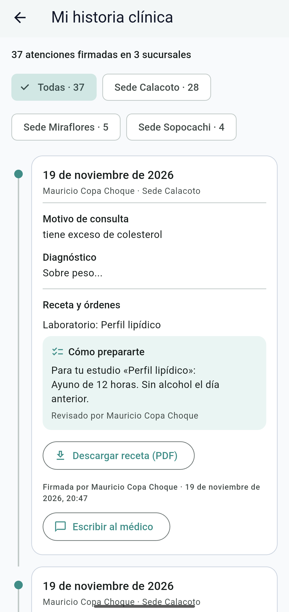

# US-40 — Preparación para estudios

> Como paciente, quiero saber cómo prepararme para el estudio que me pidieron,
> con un texto revisado por mi médico.

## Cómo funciona

1. El médico firma la atención. Por **cada orden** se busca su preparación en el
   catálogo de la organización (`Service.preparation`):
   - primero por el nombre del estudio (parecido ≥ 0,75);
   - si no aparece, en el corpus de US-32 con embeddings.
2. **Sin fuente no se genera nada** (`no_source`): no se inventa una preparación.
3. Con fuente, Gemini la reescribe en lenguaje simple a partir de la preparación
   del catálogo y las observaciones del médico. **Al modelo no le llega quién es
   el paciente**, ni siquiera el diagnóstico.
   - Sin proveedor, o si el modelo falla, el borrador es el texto del catálogo,
     marcado `generated_by="catalogo"` (estado `from_catalog`).
   - Una falla no tumba la firma.
4. Nace en **borrador**. El médico la ve en *Textos por validar*, con un aviso si
   el texto trae números que no están en la fuente, y la aprueba, corrige o
   descarta. Puede reintentarla con `POST /api/ai/orders/<id>/preparation/`.
5. El paciente la ve en el móvil, en *Mi historia clínica*, debajo de su orden
   («Cómo prepararte»), **sólo si está aprobada**.

## Casos probados (`backend/tests/test_us40.py`, 28 pruebas)

Verificadas por mutación: al quitar cada guarda, alguna prueba cae. El filtro por
organización no se puede mutar aislado porque el RLS ya lo garantiza; está
documentado en el docstring.

| # | Caso | Resultado esperado |
|---|---|---|
| 1 | Al firmar con una orden de un estudio del catálogo | Un borrador por orden, ligado a la orden y la atención |
| 2 | Qué recibe el modelo | El estudio, la preparación y las observaciones; nunca nombre, CI ni diagnóstico |
| 3 | Orden sin preparación en el catálogo | `no_source`: no se genera |
| 4 | Servicio inactivo, sin preparación o de otro estudio | No cuenta como fuente |
| 5 | Catálogo de otra organización | No cuenta como fuente |
| 6 | Sin proveedor de IA | Borrador con el texto del catálogo (`from_catalog`) |
| 7 | El modelo falla | Queda el catálogo y la firma sigue |
| 8 | Falla inesperada | La firma no se cae |
| 9 | Dos órdenes | Dos preparaciones |
| 10 | Reintentar cuando se completó el catálogo | Se genera |
| 11 | Reintentar con una viva / una descartada | No hay dos vivas; la descartada se rehace |
| 12 | Reintentar sobre una atención sin firmar | No se genera |
| 13 | Otro médico del centro reintenta | Rechazado |
| 14 | Otra organización reintenta | Rechazado |
| 15 | Texto con números que no están en la fuente | La bandeja del médico lo advierte |
| 16 | Texto fiel a la fuente | Sin advertencias |
| 17 | El paciente la pide | Sólo la aprobada, junto a su orden |
| 18 | Parecido de nombres y el servicio más específico | Gana el más específico |

En el móvil, `mobile/test/clinical_record_test.dart`: «US-40: la preparación
aprobada sale debajo de su orden».

## Prueba en el teléfono (19/11/2026, backend local)

- Mauricio Copa (`medico1@sangabriel.test`) atiende a Jimena Flores
  (`paciente1@sangabriel.test`) y le pide **Laboratorio: Perfil lipídico**.
- Al firmar se generó el borrador desde el catálogo (sin clave de Gemini en
  local). Mauricio lo aprobó en *Textos por validar*.
- En el móvil, Jimena ve «Cómo prepararte»: *Ayuno de 12 horas. Sin alcohol el
  día anterior.*, revisado por su médico.

### Lo que salió de la prueba

Dos atenciones se firmaron sin la orden: el botón «Firmar atención» estaba
junto al diagnóstico, arriba de *Receta y órdenes*, y una orden escrita sin
pulsar «Agregar orden» se perdía al firmar sin aviso. Se corrigió en la web:

- «Firmar la atención» va al final, en su propio panel, con el resumen de lo
  que se firma.
- No deja firmar si hay un medicamento o una orden escritos sin agregar.
- El diálogo avisa si la atención va sin receta ni órdenes.

**Pendiente:** la captura contra producción, con Gemini, después del deploy.
